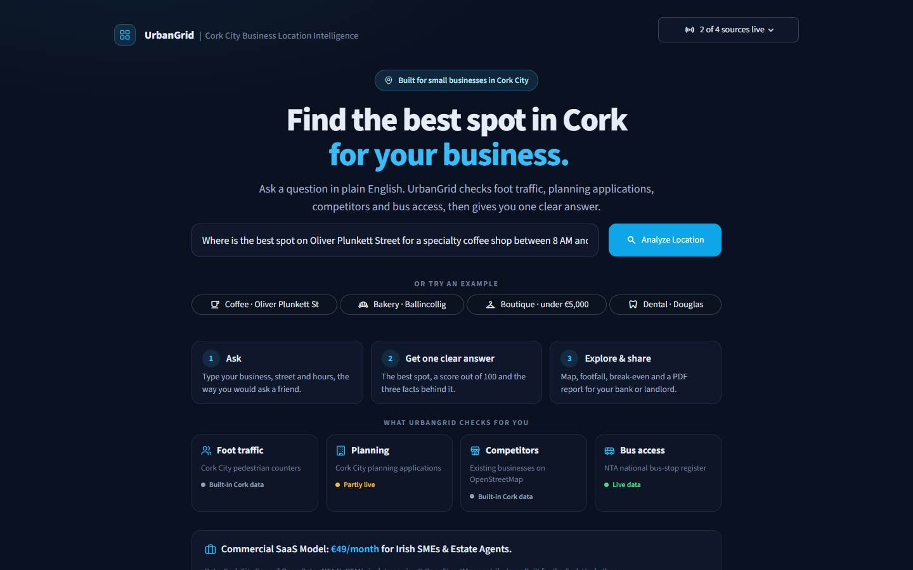
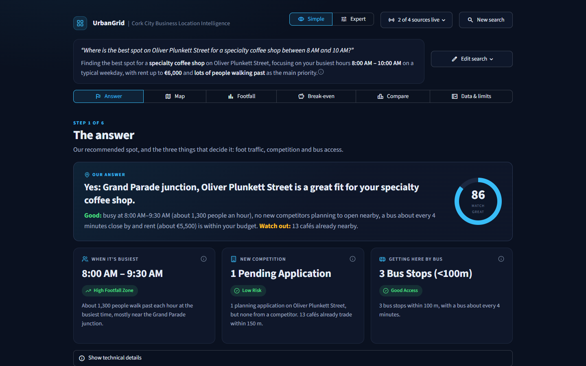
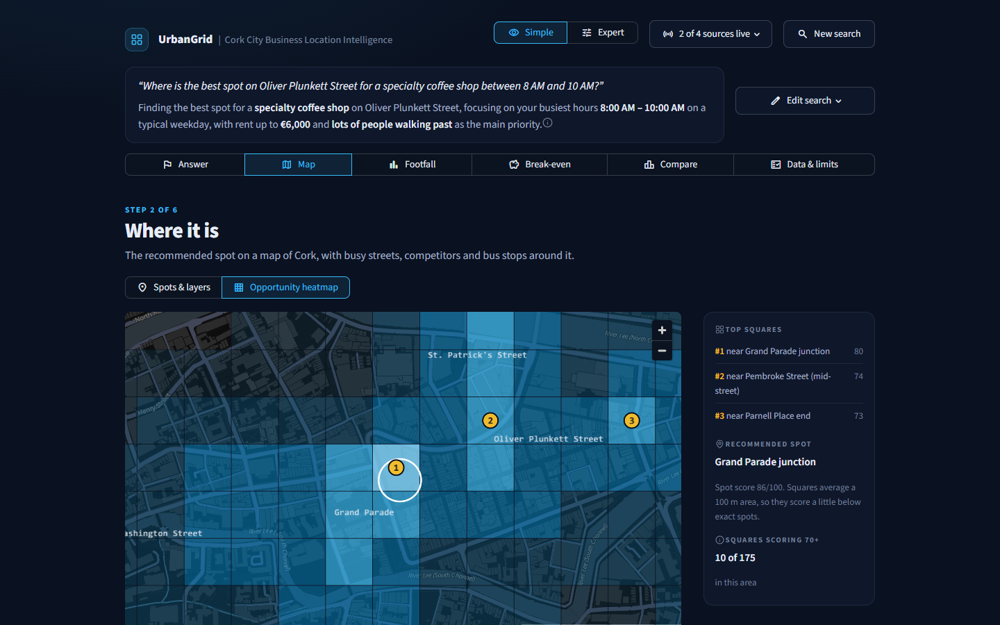
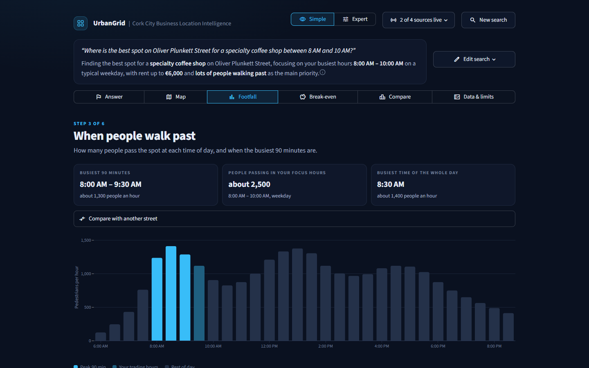
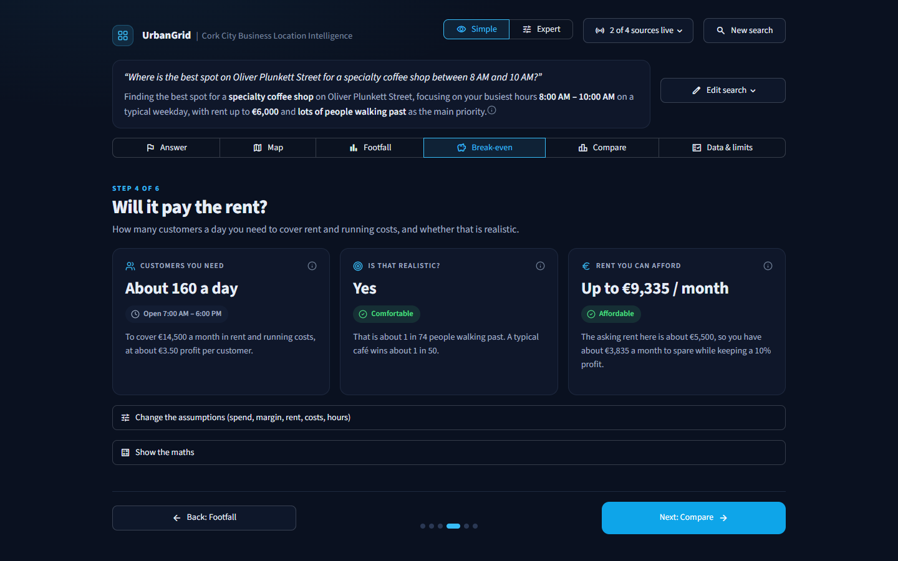
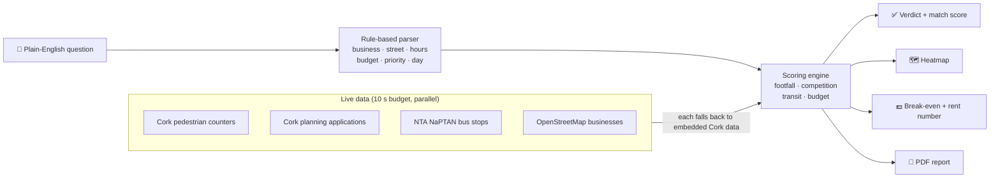

<div align="center">

# 🟦 UrbanGrid

### Instant location intelligence for retail expansion in Cork City

**Ask one question in plain English. Get one clear answer about where to open your business.**

[](#-built-for-corkathon-2026)
[](https://www.python.org/)
[](https://streamlit.io/)
[](#-data-sources)

<!-- Replace the link below with your Streamlit Community Cloud URL -->
**[▶ Live demo](https://share.streamlit.io/)** · [Features](#-features) · [How it works](#-how-it-works) · [Quick start](#-quick-start) · [Data sources](#-data-sources)

<br>



</div>

---

## 💡 Why UrbanGrid

Choosing a location is the biggest bet a small business makes, and in Cork it is usually made on gut feel. Large retailers pay consultants for footfall studies. A first-time café owner can't.

The data that answers the question is already public. Cork City Council publishes planning applications and pedestrian counters, the National Transport Authority publishes every bus stop in Ireland, and OpenStreetMap maps the businesses already trading. It is scattered across portals, formats and coordinate systems that no small-business owner has time to learn.

**UrbanGrid brings it together into one plain-English answer:**

> **You ask:** *"Where is the best spot on Oliver Plunkett Street for a specialty coffee shop between 8 AM and 10 AM?"*
>
> **UrbanGrid answers:** *"Yes: Grand Parade junction, Oliver Plunkett Street is a great fit for your specialty coffee shop."* **Match score 86/100**, about 1,300 people an hour at peak, no competing planning applications, a bus about every 4 minutes. Watch out for the 13 cafés already nearby.

---

## ✨ Features

<table>
<tr>
<td width="50%" valign="top">

### 🎯 One clear answer
A one-sentence verdict with a match score, plus three action cards for **peak hours**, **planning & competition** and **bus access**.

### 🗺️ Opportunity heatmap
Around 500 squares of 100 m across the city centre, Douglas and Ballincollig, all scored with the same formula, with the top 3 squares marked.

### 🚶 Footfall by hour
Finds the busiest 90 minutes within your hours. Switch between **weekday, Saturday and Christmas season**, or compare two streets.

</td>
<td width="50%" valign="top">

### 💶 Break-even & rent negotiation number
How many customers a day you need, whether that is realistic, and the **most rent the spot can support** while you keep a 10% profit.

### 📄 One-click PDF report
A two-page area report with the verdict, footfall chart, break-even figures and nearby competitors, ready for a bank, landlord or business partner.

### 👁️ Simple / Expert modes
Plain-English sentences for first-time owners. Every table, formula and data source stays one click away for analysts and estate agents.

</td>
</tr>
</table>

**Built to never crash.** Every data source falls back on its own to an embedded Cork dataset, the header shows exactly which sources are live, and the full demo works with the internet switched off.

---

## 📸 Screenshots

<table>
<tr>
<td width="50%"><p align="center"><b>The answer</b>: verdict, match score and three action cards</p></td>
<td width="50%"><p align="center"><b>Opportunity heatmap</b>: every 100 m square scored</p></td>
</tr>
<tr>
<td width="50%"><p align="center"><b>Footfall by hour</b>: the busiest 90 minutes highlighted</p></td>
<td width="50%"><p align="center"><b>Will it pay the rent?</b>: break-even and rent negotiation number</p></td>
</tr>
</table>

---

## ⚙️ How it works



### 1. Understanding the question
A lightweight **rule-based parser** extracts the business type, street, hours, budget, priority and day (for example "Saturday" or "Christmas") from plain English. It needs no API key, costs nothing to run, answers instantly and cannot invent facts. Every setting can also be changed by hand.

### 2. Finding the peak
Hourly footfall profiles are interpolated to half-hour slots, and a sliding 90-minute window finds the busiest stretch within your focus hours.

### 3. Scoring every spot
Each candidate spot gets four scores between 0 and 1: footfall $F$, competition $C$, transit $T$ and budget fit $B$. They are weighted by the priority you choose:

$$
\text{Score} = 100\,\big(w_F F + w_C C + w_T T + w_B B\big), \qquad \sum w = 1
$$

| Priority | $w_F$ | $w_C$ | $w_T$ | $w_B$ |
|---|:-:|:-:|:-:|:-:|
| High Morning Footfall | 0.50 | 0.20 | 0.20 | 0.10 |
| Low Competitor Density | 0.25 | 0.45 | 0.20 | 0.10 |
| High Transit Access | 0.25 | 0.20 | 0.45 | 0.10 |

Competition blends **future** rivals (pending planning applications within 200 m) with **existing** rivals (businesses of the same kind within 150 m):

$$
C = 0.6\left(1 - \frac{\min(n_{\text{applications}},\,4)}{4}\right) + 0.4\left(1 - \frac{n_{\text{existing}}}{\max n_{\text{existing}}}\right)
$$

### 4. Building the heatmap
Footfall between measured spots is estimated with inverse-distance weighting, fading away from the monitored streets:

$$
\hat f(x) = \frac{\sum_i w_i f_i}{\sum_i w_i}\, e^{-\max(d_{\min}-60,\,0)/120}, \qquad w_i = \frac{1}{\max(d_i, 25)^2}
$$

### 5. Will it pay the rent?
With average spend $s$, gross margin $m$, trading days $D$, rent $R$ and other monthly costs $O$:

$$
N_{\text{break-even}} = \frac{R + O}{s \cdot m \cdot D}
$$

With $P$ passers-by a day and a typical capture rate $\bar c$ for the business type, the **rent negotiation number** is the highest rent that still leaves a 10% profit:

$$
R_{\max} = \bar c P\, s\, D\,(m - 0.10) - O
$$

---

## 📊 Data sources

| Source | Publisher | What UrbanGrid uses it for | Status |
|---|---|---|---|
| [Pedestrian footfall counters](https://data.corkcity.ie/) | Cork City Council | When people walk past, peak hours, heatmap | ⚠️ Embedded profile. The live datastore currently returns no rows; the app switches to live counts automatically once they are published. |
| [Planning applications](https://data.corkcity.ie/) | Cork City Council | Future competitors and pipeline risk | ✅ Live, matched by street address |
| [NaPTAN stop points](https://data.gov.ie/) | National Transport Authority | Bus stops within walking distance | ✅ Live |
| [OpenStreetMap](https://www.openstreetmap.org/) (Overpass API) | OpenStreetMap contributors | Cafés, bakeries, dentists and clothing shops already trading | ✅ Embedded snapshot, refreshed in the background |

> [!NOTE]
> **Estimates, clearly labelled.** Saturday and Christmas adjustments, zone asking rents, bus frequencies and break-even defaults are estimates based on typical Irish high-street patterns. They are marked as estimates in the app and listed on the **Data & limits** page. Break-even assumptions are fully editable.

---

## 🚀 Quick start

**Requirements:** Python 3.10 or newer (3.12 recommended).

```bash
# 1. Clone the repository
git clone https://github.com/Surya182003/urbangrid.git
cd urbangrid

# 2. Create and activate a virtual environment
python -m venv .venv
source .venv/bin/activate        # Windows: .venv\Scripts\activate

# 3. Install dependencies
pip install -r requirements.txt

# 4. Run the app
streamlit run app.py
```

The app opens at **http://localhost:8501**. No API keys or secrets are needed.

### Deploy to Streamlit Community Cloud
1. Push the repository to GitHub.
2. Go to [share.streamlit.io](https://share.streamlit.io/) and choose **Create app**.
3. Select the repository, branch `main` and main file `app.py`.
4. Under **Advanced settings**, choose Python 3.12, then **Deploy**.

---

## 🧱 Tech stack

| Layer | Technology |
|---|---|
| App framework | **Streamlit**: UI, navigation, caching, downloads |
| Data processing | **Pandas**, **NumPy**: scoring, interpolation, peak detection |
| Maps | **pydeck** (deck.gl) on a CARTO dark basemap |
| Charts | **Altair** (Vega-Lite) |
| Reports | **fpdf2**: generated PDF area reports |
| Data access | **Requests**: CKAN datastore APIs and the Overpass API |
| Hosting | **Streamlit Community Cloud** |

```text
urbangrid/
├── app.py                  # The full application
├── requirements.txt        # Python dependencies
├── .streamlit/
│   └── config.toml         # Dark theme and server settings
└── docs/
    └── screenshots/        # Images used in this README
```

---

## 🧭 Honest limits

UrbanGrid is a decision-support tool, not a guarantee. It does not yet use:

- **Measured Saturday or seasonal footfall.** Weekend and Christmas figures are adjusted estimates.
- **Live rental listings.** Zone rents are typical asking rents.
- **Live bus timetables.** Bus frequencies are typical daytime estimates.
- **Spending power or demographics** of the people walking past.

Always visit the site in person and get professional advice before signing a lease.

---

## 🛣️ Roadmap

- [ ] Real Saturday and seasonal footfall as Cork's counters publish historical data
- [ ] Planning alerts: *"Tell me when a new café applies within 200 m of my shortlist"*
- [ ] Live rental listings and GTFS bus timetables
- [ ] More Irish cities: Dublin, Galway, Limerick and Waterford
- [ ] White-label PDF reports for estate agents

### 💼 Business model
**Commercial SaaS at €49/month** for Irish SMEs and estate agents: unlimited searches, saved shortlists, planning alerts and branded reports.

---

## 🏆 Built for Corkathon 2026

UrbanGrid was designed and built for **Corkathon 2026**. The challenge was to turn Cork's open data into something genuinely useful for the people who live and work in the city.

Our answer: give every first-time business owner in Cork the same location insight that large retail chains pay consultants for.

---

## 🙏 Acknowledgements

- **Cork City Council** for planning and footfall data on [data.corkcity.ie](https://data.corkcity.ie/)
- **National Transport Authority** for NaPTAN stop data on [data.gov.ie](https://data.gov.ie/)
- **OpenStreetMap contributors** for business locations. Map data © OpenStreetMap contributors, available under the [Open Database Licence (ODbL)](https://www.openstreetmap.org/copyright).
- **CARTO** for the dark basemap tiles

<div align="center">
<br>

**UrbanGrid** · Cork City Business Location Intelligence · Corkathon 2026

</div>
